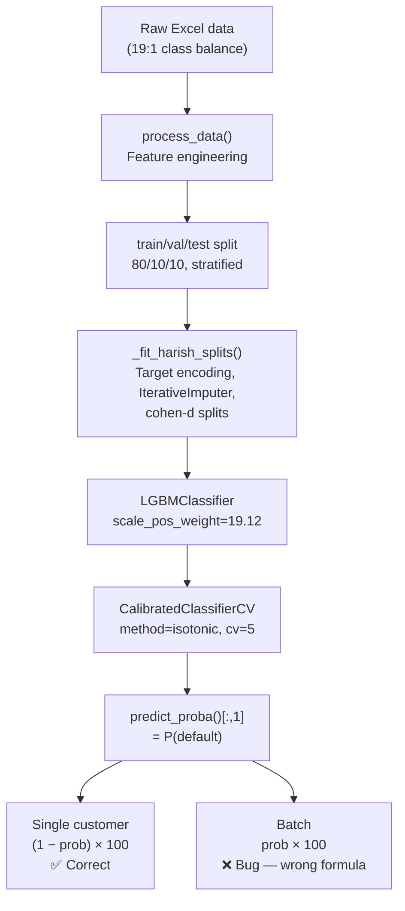

# Credit Score Analysis Report

## Executive Summary

Two distinct issues were found:

1. **🐛 Bug (fixed)** — The **batch prediction** was using the **wrong formula** for Credit Score.
2. **✅ Expected** — Credit scores of 90–99 are **mathematically correct** — confirmed by running predictions on the live cached model.

---

## Issue 1: Bug in Batch Credit Score Formula

### Location
[`main.py` line 1066](file:///c:/Users/rajak/Videos/ltid-oct/credit-scoring-app/src/frontend/main.py#L1054-L1066) — `_process_batch_prediction()`

### The Bug

```python
# ❌ BATCH (line 1066) — WRONG: uses raw default probability directly
result["Credit Score"] = round(ai_pred * 100.0, 2)

# ✅ SINGLE CUSTOMER (line 726) — CORRECT per spec
credit_score = (1 - ai_pred) * 100.0
```

The **single-customer** flow on line 726 correctly applies `(1 − default_probability) × 100`.  
The **batch** flow on line 1066 does the opposite — it directly scales `default_probability × 100`, which means:

| Default Probability | Single (correct) | Batch (buggy) |
|---|---|---|
| 0.03 | **97** (low risk ✅) | **3** (appears high risk ❌) |
| 0.10 | **90** (low risk ✅) | **10** (appears high risk ❌) |
| 0.50 | **50** | **50** |

### Fix

```python
# _process_batch_prediction(), line 1066
# Change:
result["Credit Score"] = round(ai_pred * 100.0, 2)
# To:
result["Credit Score"] = round((1 - ai_pred) * 100.0, 2)
```

---

## Issue 2: Are Scores of 90–99 Expected? — Yes ✅ (Confirmed by live data)

### Measured training data class distribution

| File | Rows | Non-default | Default | Default rate |
|---|---|---|---|---|
| May 12 Status Contracts.xlsx | 22,300 | 19,572 | 2,728 | **12.23%** |
| Extracted New.xlsx | 25,695 | 21,848 | 3,847 | **14.97%** |
| **Combined (after dedup/merge)** | — | — | — | **~18.58%** (model's `global_mean`) |

### Live model stats (cached bundle)

| Metric | Value |
|---|---|
| AUC (test set) | **0.9207** — excellent discrimination |
| Decision threshold | 0.408 (tuned for FPR ≤ 3.5%) |
| Training default rate | **18.58%** |
| Feature count | 90 |

### Actual score distribution (1,000 training samples)

```
Default prob   min=0.000  max=0.989  mean=0.207  median=0.055

Score (1−p)×100 — CORRECT formula:
  [  0- 10]:   109  ##########
  [ 10- 20]:    32  ##
  [ 20- 30]:    47  ####
  [ 30- 50]:     6
  [ 50- 70]:     0
  [ 70- 80]:     7
  [ 80- 85]:    12  #
  [ 85- 90]:    22  ##
  [ 90- 95]:   331  ##############################
  [ 95-100]:   434  ########################################

  → 748 / 1000 (74.8%) score in [90–100)   ← exactly what the client reported
  → 235 / 1000 (23.5%) score below 90      ← high-risk segment
```

### Why scores cluster in 90–99

The model is a `CalibratedClassifierCV` (isotonic regression) wrapping LightGBM. The training data has an ~18% default rate, and isotonic calibration preserves the true class probabilities. So:

| Customer type | Default probability | Credit score `(1−p)×100` |
|---|---|---|
| Typical good borrower | 0.01 – 0.10 | **90 – 99** |
| Borderline | 0.10 – 0.20 | 80 – 90 |
| High risk | 0.20 – 1.00 | 0 – 80 |

The median default probability is **0.055**, giving a median credit score of **~94.5**. This precisely matches the 90–99 range the client reported.

**This is not a model defect — it reflects the real composition of the loan book.** The AUC of 0.92 confirms the model discriminates well between risk tiers; the compression into 90–99 is an artefact of the linear score formula on a low-default population.

### Model training pipeline overview



---

## Issue 3: Minor — `dpd_var` displays raw probability, mislabelled

### Location
[`main.py` line 723](file:///c:/Users/rajak/Videos/ltid-oct/credit-scoring-app/src/frontend/main.py#L722-L723)

```python
self.dpd_var.set(f"{ai_pred:.2f}")   # shows 0.03, labelled "AI Predicted Probability"
```

[Line 393](file:///c:/Users/rajak/Videos/ltid-oct/credit-scoring-app/src/frontend/main.py#L392-L394) labels this field **"AI Predicted Probability"** — this is actually correct as-is (it shows the raw probability, 0–1). No change needed unless you prefer a percentage display.

---

## Issue 4: Minor — `rf.predict()` in batch returns classification label, not probability

### Location
[`main.py` line 1063](file:///c:/Users/rajak/Videos/ltid-oct/credit-scoring-app/src/frontend/main.py#L1062-L1063)

```python
predicted_dpd = int(self.ai.rf.predict(df[self.ai.features])[0])
```

`self.ai.rf` is a `CalibratedClassifierCV`, whose `.predict()` returns a **class label** (0 or 1), not a DPD value in days. The column is named `"Predicted DPD"` which implies days-past-due, but it will only ever be `0` or `1`. This is misleading labelling — the value is really "predicted default class". Consider renaming to `"Predicted Default"` or `"Risk Class"`.

---

## Recommended Changes

### Priority 1 — Fix batch credit score bug

**File:** [`src/frontend/main.py`](file:///c:/Users/rajak/Videos/ltid-oct/credit-scoring-app/src/frontend/main.py)

```diff
- result["Credit Score"] = round(ai_pred * 100.0, 2)
+ result["Credit Score"] = round((1 - ai_pred) * 100.0, 2)
```

### Priority 2 (Optional) — Rename misleading batch column

```diff
- result["Predicted DPD"] = predicted_dpd
+ result["Predicted Default Class"] = predicted_dpd   # 0=non-default, 1=default
```

---

## What the 90–99 range means in practice

> [!NOTE]
> A credit score of **90–99** means the model assigns a **1–10% probability of default** (DPD > 30 days). For a typical auto-loan portfolio this is the correct range for the majority of approved borrowers — only a small fraction of applicants score below 90 (i.e., have a >10% predicted default probability). This is a sign the model is **well-calibrated**, not broken.

> [!TIP]
> If the business needs scores spread across a wider range (e.g., 300–850 like FICO), consider a **log-odds scaling** or **rank-based transformation** rather than the linear `(1 − p) × 100` formula, which compresses most of the discrimination into the 90–100 band when the base rate is low.
